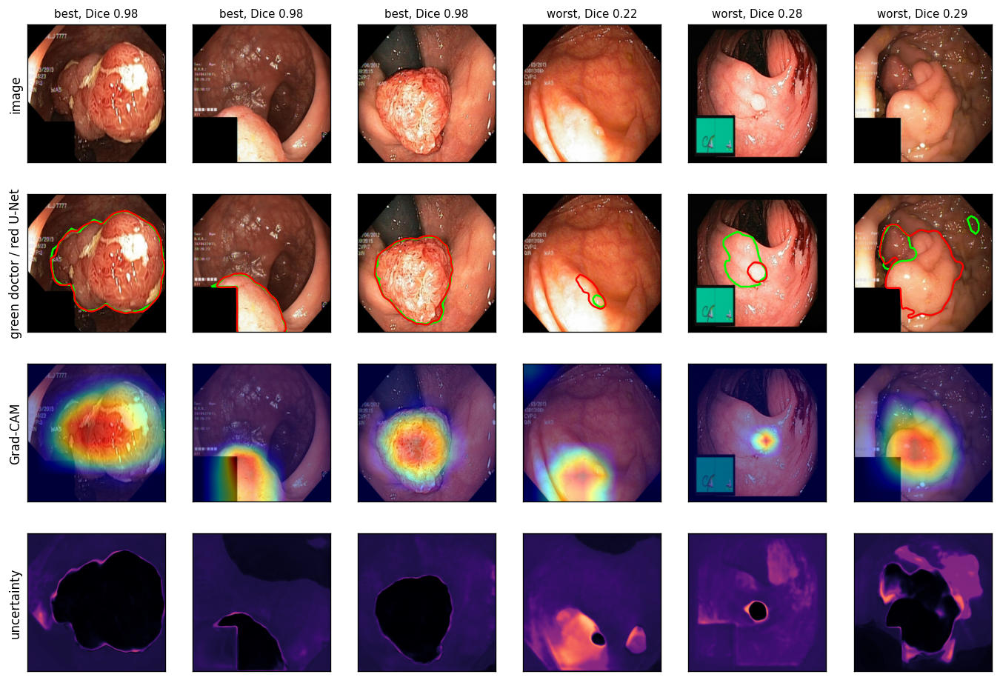

# Polyp outlines in colonoscopy images: U-Net vs. a brightness threshold

**Biomedical Image Analysis · M.Sc. Applied Data Science and AI · SRH University Munich · WS 2026/27**
**Authors:** Chandana Gurusiddappa, Dineshkumar Swaminathan · **Last updated:** 24.11.2026

Data: Kvasir-SEG (Jha et al., MMM 2020). The images are **not** in this repository: their
licence allows research and education only. `scripts/download_data.py` fetches them.

## Result (test set, 120 images, used once)

| Setting | Dice | IoU | Recall |
|---|---|---|---|
| floor: always polyp | 0.243 | 0.153 | 1.000 |
| brightness threshold (Otsu) | 0.323 | 0.223 | 0.598 |
| U-Net, encoder from scratch (3 seeds) | 0.756 ± 0.009 | 0.661 ± 0.014 | 0.807 ± 0.021 |
| U-Net, ImageNet-pretrained encoder (3 seeds) | **0.862 ± 0.007** | **0.788 ± 0.011** | **0.912 ± 0.016** |

Pretraining is the only change between the two U-Nets and adds 0.106 Dice (better on 104 of
120 test images, Wilcoxon p = 5.3 × 10⁻¹³, Holm-corrected; 95 % bootstrap interval of the pretrained model: 0.832–0.888); it helps most for small polyps (0.843 vs. 0.706).
Images from a later batch, unlike anything in training, score lower (0.809 vs. 0.874).
Full analysis: [report.md](report.md).

---

## Folders

| Folder | What | Who |
|---|---|---|
| [`chandana/`](chandana/) | **models and results**: `03_models_and_evaluation` (baseline, U-Nets, test evaluation, Grad-CAM) and `04_template_extras` (B5 sanity check, C3 calibration) | Chandana |
| [`dinesh/`](dinesh/) | **data**: `01_data_and_floor`, `02_look_and_leakage`, the template Part A, and `hard_images` (which test images are hard) | Dinesh |
| `src/`, `scripts/` | shared code: `scripts/`, `src/data.py`, `src/duplicates.py` belong to the data part; `src/baseline.py`, `unet.py`, `train.py`, `metrics.py`, `stats.py` to the models part | see "Who is responsible for what" |
| `results/` | all tables and figures (parts A, B, C and D1) | made by the notebooks above |
| `splits/` | train / validation / test file lists | `scripts/make_split.py` |

## 1 · My question in one sentence  *(Session 12 · report section 1)*

Can a U-Net outline polyps in colonoscopy images well enough to help a doctor not miss one,
and how much better is it than a simple brightness threshold?

## 2 · Five lines  *(Session 6 · report sections 1–3)*

| | |
|---|---|
| **Question** | Can a U-Net segment polyps in single colonoscopy frames better than a brightness threshold? |
| **Images** | Kvasir-SEG: 1,000 RGB colonoscopy frames (JPEG, 332–1920 px wide), Vestre Viken Health Trust, Norway. https://datasets.simula.no/kvasir-seg/ (46 MB, unchanged since 2019, downloaded 19.11.2026) |
| **Labels** | One binary mask per image (white = polyp). Every image contains a polyp. Polyps cover on average 15.4 % of the image (median 11.4 %, from 0.5 % to 81 %); 200 images have a polyp under 5 % of the image. |
| **Metric** | Dice per image, averaged (main), plus IoU, precision and recall, threshold 0.5; mean ± std over 3 seeds. Not pixel accuracy: about 85 % of pixels are background. |
| **Baseline** | Floor: "always background" = Dice 0.000; "always polyp" = Dice 0.243 ± 0.184 (± = spread over the 120 test images, not over seeds; the floor has no training) on test. Classical: Lab lightness L + Otsu threshold + clean-up + largest region (test Dice 0.323). Our first idea, redness (Lab a*), scored only 0.02 on validation: polyps are brighter than the bowel wall, not redder. |

## 3 · Flat images or stacks?  *(Session 10 · report section 2)*

- **2D or 3D:** 2D. One RGB video frame per file, no slices or volumes.
- **Pixel size:** not reported. Endoscopy has no fixed scale: it changes with the distance between the camera and the bowel wall. Polyp size is therefore given as a share of the image.
- **Image size:** 333 different sizes, from 332 × 352 to 1920 × 1072 px; the most common is 622 × 530. All methods use copies shrunk to 256 × 256 (masks with nearest-neighbour, so they stay 0/1).

## 4 · Who made the labels?  *(Session 11 · report section 2)*

1. **Who:** an engineer and a medical doctor outlined each polyp in Labelbox; an experienced gastroenterologist then checked the outlines (Jha et al., 2020).
2. **How many / agreement:** one final mask per image; the separate outlines are not released. Agreement between annotators: **not reported**.
3. **Ceiling:** unknown, because no second annotation exists. The masks are filled polygons with smooth edges, so a Dice close to 1 is not meaningful. The masks are stored as JPEG: 0.73 % of mask pixels are not exactly black or white, so we call every pixel above 127 "polyp".

## 5 · Leakage check  *(Session 7 · report sections 2 and 5)*

1. **Several images per patient? Split by patient?** Probably yes, and no. The file names are random IDs and there are no patient IDs, so we cannot split by patient. We found one pair that shows the same polyp on the same date from another angle; it sits in train and validation. Our numbers may therefore be a little optimistic.
2. **Copies?** No byte-identical files. Our check (fingerprint "dHash" distance ≤ 3 of 64 **and** mask IoU ≥ 0.5, limits chosen by looking at the 25 closest pairs) found **7 near-duplicate pairs** (3 identical photos, 4 almost the same frame). One pair crossed into the test set; we dropped its training copy. No mirrored copies. Details: `dinesh/02_look_and_leakage.ipynb`, `results/duplicates.csv`.
3. **Statistics and augmentation after the split, training only?** Yes. We split first. Normalisation uses ImageNet values or training-set statistics only; flips, rotations and brightness changes are applied to training images only.
4. **Epochs and thresholds on validation, never test?** Yes. Best epoch by validation Dice; threshold fixed at 0.5 in advance; the classical threshold is tuned on validation. The test set is used once, at the end.
5. **Could something in the image give the label away?** Every image has a polyp, so nothing can give away "polyp yes/no". But: a black octagon border, a black box in the bottom-left corner (the position map was blacked out), text with date and time, and sometimes instruments. **13 test images still show the coloured position box, and none of the training images do.** We report Dice on the polyp only, not pixel accuracy.

**The split** (`scripts/make_split.py`, seed 42): **train 779 / validation 100 / test 120**, 1 dropped.
Test = the authors' own list of 120 (`Data-split/val.txt` on their GitHub), so our test numbers can be compared with published ones. Validation = 100 random training images that have no near-copy. **23 test images come from a later batch** (file names `cjyz…`, `ck2…`) with no images in train or validation; we report their Dice separately (0.809 for the pretrained U-Net, vs. 0.874 for the rest).

## 6 · Progress: one turn of the cycle  *(Session 12)*

- [x] 0 · Question: one sentence (block 1)
- [x] 1 · Load: my data downloads in Colab (notebook 03 runs end to end on a Colab T4)
- [x] 2 · Look: 20 images with their labels, looked at by eye (`results/fig_20_examples.png`)
- [x] 3 · Count: share of foreground pixels; the floor (`dinesh/01_data_and_floor.ipynb`)
- [x] 4 · Check: twins, the same patient twice (block 5)
- [x] 5 · Table: the data table in report section 2 is filled in
- [x] 6 · Number: a first network next to the floor and the classical baseline (Result above, `results/C1_results.md`)

## 7 · How to run it  *(report section 4)*

- **Environment:** Google Colab (free GPU) or our own laptops; Python 3, `pip install -r requirements.txt`.
- **Order:**
  1. `python scripts/download_data.py`: data into `data/` (46 MB).
  2. `python scripts/make_split.py`: `splits/train.txt`, `val.txt`, `test.txt` and `results/duplicates.csv` (about a minute).
  3. `dinesh/01_data_and_floor.ipynb`: checks, polyp share, floor, 256 × 256 cache.
  4. `dinesh/02_look_and_leakage.ipynb`: 20 examples, copies, split check, test-set check.
  5. `dinesh/BIA_W6_Project_Template_PartA.ipynb`: the course template, Part A (A1–A5).
  6. `chandana/03_models_and_evaluation.ipynb` **on Colab, T4 GPU**: brightness baseline, U-Net from scratch vs. ImageNet-pretrained (3 seeds each), test set once, Grad-CAM, uncertainty (`results/B*`, `results/C*`).
  7. `chandana/04_template_extras.ipynb` (Colab, no GPU needed, about 10 min): loads the 6 saved U-Nets from Google Drive and adds the template's B5 heat-map sanity check, C3 calibration and exact package versions.
- **Which file makes which table or figure:**

| Output | Made by |
|---|---|
| `results/fig_polyp_share.png`, floor numbers | `dinesh/01_data_and_floor.ipynb` |
| `results/fig_20_examples.png`, `results/fig_closest_pairs.png` | `dinesh/02_look_and_leakage.ipynb` |
| `splits/*.txt`, `results/duplicates.csv` | `scripts/make_split.py` |
| `results/A1_examples.png`, `A2_counts.csv`, `A5_data_table.md` | `dinesh/BIA_W6_Project_Template_PartA.ipynb` |
| `results/B1_baseline_examples.png`, `B2_learning_curves.png`, `B2_histories.json` | `chandana/03_models_and_evaluation.ipynb` (Part B) |
| `results/C1_results.md`, `C1_boxplot.png`, `C2_intervals_and_groups.md`, `C3_worst_cases.png`, `C4_gradcam_uncertainty.png`, `C5_summary.md` | `chandana/03_models_and_evaluation.ipynb` (Part C) |

| `results/B5_sanity.png`, `results/C3_calibration.png`, `C3_calibration.md`, `requirements.txt` (exact versions) | `chandana/04_template_extras.ipynb` |
| `results/D1_hard_images.png`, `D1_summary.md` | `dinesh/hard_images.ipynb` |
| `results/C6_stats.md` (paired tests, Holm) | `python src/stats.py` |

**Course template → our files.** We followed `BIA_W6_Project_Template.ipynb`. Its own note says segmentation projects use Part A, and U-Net cells with Dice for B and C; our file names for B and C therefore differ:

| Template step | Our file |
|---|---|
| A1 · 20 images · A2 · counts and floor · A5 · data table | `results/A1_examples.png`, `A2_counts.csv`, `A5_data_table.md` |
| A3 · twins | 0 of 120 test images have a near-twin in training (template check; no figure is made when there are none) + our own check: `results/duplicates.csv`, `fig_closest_pairs.png` |
| A4 · patients | not possible (no patient IDs), see block 5 |
| B1 · simple baseline | brightness threshold: `results/B1_baseline_examples.png` |
| B2 · borrowed network | ImageNet-pretrained U-Net: `results/B2_learning_curves.png` |
| B3 · numbers side by side | `results/C1_results.md`, `C1_boxplot.png` |
| B4 · Grad-CAM | `results/C4_gradcam_uncertainty.png` |
| B5 · heat-map sanity check | `results/B5_sanity.png` |
| C1 · three seeds | `results/C1_results.md` (mean ± std) |
| C2 · bootstrap | `results/C2_intervals_and_groups.md` |
| C3 · calibration | `results/C3_calibration.png`, `C3_calibration.md` |
| C4 · worst cases | `results/C3_worst_cases.png` |
| C5 · summary, requirements | `results/C5_summary.md`, `requirements.txt` |

**Heat maps: one we would show, one we would not trust** (template B5). We would show the worst test image with the coloured position box (`B5_sanity.png`, right column): its Grad-CAM sits on the small polyp-like spot the network marked, and with a random last layer the map spreads over the whole image (correlation 0.26), so this map does depend on what the network learned. We would not trust the best test image on the left (Dice 0.99): it looks perfect, centred on the polyp, but the map is almost the same with a random last layer (correlation 0.98), so it shows where the encoder's features are strong, not what the network learned about polyps. The same holds for a second image (correlation 1.00). Our Grad-CAM maps are therefore weak evidence; we use them only to point at where to look.

Training: Colab T4, 18.3 s per epoch, 6 runs × 30 epochs ≈ 55 min. Finished runs are saved to Google Drive, so after a disconnect, **Run all** continues where it stopped.

## 8 · Shared with my Deep Learning project?

No. Our Deep Learning project (same two people) reproduces LSTNet on time series. No data, paper or code is shared. If we reuse a small helper (for example a seed function), we will name it here and in both reports.

## Who is responsible for what

Each of us is responsible for one half and presents and defends it.

| Part | Files | Who |
|---|---|---|
| **Data**: download, mask checks, polyp share, floor, near-duplicates, split, template Part A (A1–A5), which test images are hard | `dinesh/`, `scripts/`, `src/data.py`, `src/duplicates.py` → `results/A*`, `fig_*`, `duplicates.csv`, `D1_*` | Dinesh |
| **Models and results**: brightness baseline, U-Net from scratch vs. pretrained, training on Colab, test evaluation, statistics, Grad-CAM, uncertainty, template B5 and C3 | `chandana/`, `src/baseline.py`, `unet.py`, `train.py`, `metrics.py`, `stats.py` → `results/B*`, `C*` | Chandana |
| Report, README | `report.md`, `README.md` | Chandana |

AI assistance (Claude Code): [`AI_USAGE.md`](AI_USAGE.md) and report section 7.

## Citation

Jha D., Smedsrud P. H., Riegler M. A., Halvorsen P., de Lange T., Johansen D., Johansen H. D.
*Kvasir-SEG: A Segmented Polyp Dataset.* MultiMedia Modeling (MMM 2020), LNCS 11962,
pp. 451–462. https://doi.org/10.1007/978-3-030-37734-2_37
