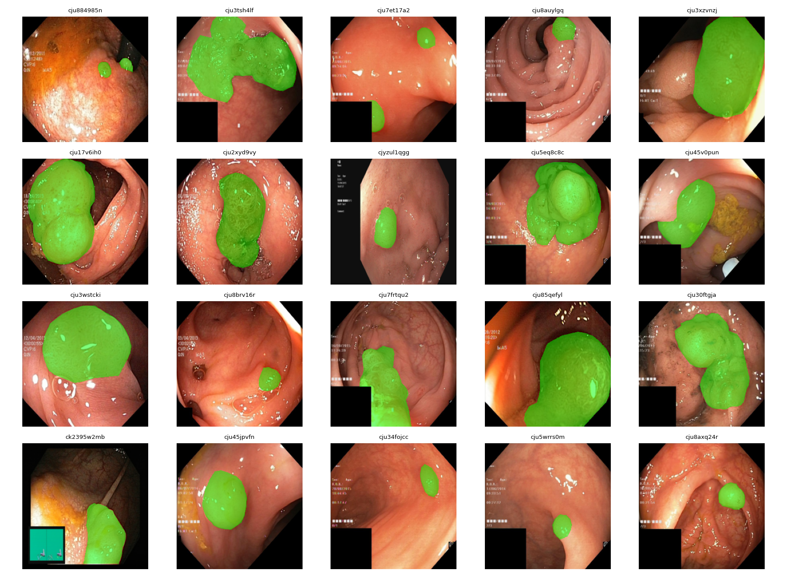

# [Title: the clinical question and how you answered it]

**Biomedical Image Analysis · M.Sc. Applied Data Science and AI · SRH University Munich · Winter semester 2026/27**
**Author(s):** Chandana Gurusiddappa, Dineshkumar Swaminathan · **Repository:** https://github.com/Chandana18G/kvasir-seg-polyp-segmentation · **Date:** [date]

> How to use this template: copy it into your repository as `report.md` (or into LaTeX or Word with the same sections).
> Replace everything in [square brackets]. The section titles follow the eight grading criteria of Session 1 (weights in brackets).
> The remaining criterion, code understanding and technical defense (15 %), is graded in the exam conversation, not in the report.
> Same structure as the Deep Learning report, plus the biomedical parts: modality, labels, patient-level split, clinical meaning.
> Shared data or paper with Deep Learning? Allowed (decided 15.10.): different questions; data preparation is graded here only; name the shared work in both reports.

---

## Abstract

[Four or five sentences: the clinical question, the data, your classical baseline, your deep-learning model, the result with its spread, what it means and what it does not.]

## 1 · The biomedical problem (15 %, with section 2)

- **Clinical question:** Colorectal polyps can turn into cancer, and polyps that are missed during colonoscopy are a known risk. A tool that outlines the polyp in each video frame could help the doctor not miss one. We ask: can a U-Net outline polyps in single colonoscopy frames well enough for this, and how much better is it than a simple brightness threshold? The user would be the endoscopist, as a second pair of eyes; the decision (remove the polyp or not) stays with the doctor.
- **Task type:** Segmentation. In: one RGB colonoscopy frame. Out: a mask with one value per pixel, polyp or background.
- **Why it is hard:** polyps vary from tiny (0.5 % of the image) to almost the whole frame, and 20 % of images have a polyp under 5 % of the image; about 85 % of pixels are background; flat polyps look like the bowel wall; light reflections, blur, stool and instruments; only 1,000 images from one hospital group; no patient IDs, so the same patient may be in training and test.

## 2 · The data (15 %, with section 1)

| | |
|---|---|
| Source, version, download date | Kvasir-SEG, https://datasets.simula.no/kvasir-seg/ (`kvasir-seg.zip`, 46 MB, unchanged since 18.11.2019), downloaded 19.11.2026. Paper: Jha et al., *Kvasir-SEG: A Segmented Polyp Dataset*, MMM 2020, LNCS 11962, pp. 451–462. Split lists from the authors' GitHub (`DebeshJha/Kvasir-SEG`, `Data-split/`). |
| Licence | No named licence. Research and educational use only, no commercial use without written permission, the paper must be cited. So the images are not in our repository; `scripts/download_data.py` fetches them. |
| Modality | Endoscopy (colonoscopy, Olympus endoscopes, Vestre Viken Health Trust, Norway); 2D RGB video frames. |
| Size | 1,000 images, each with one polyp mask. Number of patients: not reported (no patient IDs). 333 different image sizes, 332 × 352 to 1920 × 1072 px (most common 622 × 530). Pixel size in mm: not reported; endoscopy has no fixed scale. |
| Labels: who made them | An engineer and a medical doctor outlined the polyps in Labelbox; one experienced gastroenterologist checked them. |
| Labels: agreement | Not reported (one final mask per image; separate outlines not released). Ceiling therefore unknown. |
| Classes or targets | Two classes per pixel: polyp / background. Every image contains a polyp. Polyp share per image: mean 15.4 %, median 11.4 %, min 0.5 %, max 81 %; 200 of 1,000 images under 5 %. Floor on test: "always background" Dice 0.000; "always polyp" Dice 0.243 ± 0.184. |
| Splits | **Not by patient**: no patient IDs exist. Test = the authors' 120 images; validation = 100 random training images without near-copies (seed 42); train = 779; 1 image dropped (copy of a test image). |
| Preprocessing | Masks binarised with > 127 (0.73 % of mask pixels are grey from JPEG). All images and masks shrunk to 256 × 256 (images bilinear, masks nearest-neighbour). Normalisation: ImageNet values or training-set statistics only. |
| Quality checks | No broken files; every mask has the same size as its image; no empty mask. 20 images looked at by eye: black octagon border, black corner box (blacked-out position map), date/time text, reflections, sometimes instruments; masks look tight. Duplicates: 0 byte-identical, 7 near-duplicate pairs (fingerprint + mask overlap), 0 mirrored; one same-polyp pair across train/validation found by eye. **Test differs from train**: 13 test images (and no training image) still show the coloured position box; 23 test images come from a later batch with no training images. |
| Shared with Deep Learning? | No. The DL project (same partners) reproduces LSTNet on time series; all data preparation here is for this course only. |

*Figure 1: 20 random images (seed 0) with their masks in green. Made by `notebooks/02_look_and_leakage.ipynb`.*

## 3 · Experimental design (15 %)

- **The floor:** "always background" (Dice 0.000, every image has a polyp) and "always polyp" (Dice 0.243 ± 0.184 on test), computed from the masks, no training.
- **Classical baseline** (`src/baseline.py`): Lab lightness L, Otsu threshold inside the endoscope view, opening and closing, keep the largest region. Our first idea was redness (Lab a*); it scored Dice 0.02 on validation. Measuring showed why: polyps are brighter than the surrounding wall in 90 % of validation images (L +37 on 0–255) but hardly redder (a* +3.8). With lightness, validation Dice is 0.39. The clean-up radius (3, 7, 11 or 15 px) is chosen on validation.
- **Deep-learning model** (`src/unet.py`): a 2D U-Net with a ResNet-34 encoder and a 4-step decoder with skip connections; one output per pixel. Loss: binary cross-entropy + Dice loss (cross-entropy gives smooth gradients; Dice loss counters the 85 % background). Adam, learning rate 1e-4, batch 16, 30 epochs, input 256 × 256, ImageNet mean/std; the epoch with the best validation Dice is kept; threshold 0.5, fixed in advance.
- **Augmentation** (training images only, `src/train.py`): left-right and up-down flips and 90° turns (an endoscope can see a polyp from any side and rotation, so these are plausible), brightness ± 10 % (the light changes with distance). No hue changes, because colour and brightness are real cues here.
- **Comparisons:** one change at a time. The two U-Nets differ only in the encoder's starting weights: random ("from scratch") vs. ImageNet-pretrained. Same split, epochs, settings and seeds (0, 1, 2); mean ± standard deviation over the 3 seeds.

## 4 · Implementation and reproducibility (25 %)

- **Run it:** `pip install -r requirements.txt`, then `python scripts/download_data.py`, `python scripts/make_split.py`, notebooks `01`, `02`, `BIA_W6_Project_Template_PartA`, and `03_models_and_evaluation` on Google Colab (T4 GPU, Runtime → Run all). Every notebook clones the repository and downloads the data itself when run on Colab. The download script handles the Simula server's incomplete certificate chain (certificate checking stays on).
- **Seeds, hardware, training time:** split seed 42; training seeds 0, 1, 2; Google Colab T4 GPU; [time per epoch] s per epoch, 6 runs × 30 epochs.
- **Where the results come from:**

| Output | Made by |
|---|---|
| `results/fig_polyp_share.png`, floor | `notebooks/01_data_and_floor.ipynb` |
| `results/fig_20_examples.png`, `results/fig_closest_pairs.png` | `notebooks/02_look_and_leakage.ipynb` |
| `splits/*.txt`, `results/duplicates.csv` | `scripts/make_split.py` |
| `results/A1_examples.png`, `A2_counts.csv`, `A5_data_table.md` | `notebooks/BIA_W6_Project_Template_PartA.ipynb` |
| `results/B1_*`, `B2_*`, `C1_*` … `C5_*` | `notebooks/03_models_and_evaluation.ipynb` |

## 5 · Evaluation, validation and critical analysis (15 %)

| Setting | [metric] mean | ± spread | seeds |
|---|---|---|---|
| floor | | | |
| classical baseline | | | |
| deep-learning model | | | |
| + [change] | | | |

- **Metrics that fit the task:** [Dice and IoU for masks; sensitivity and specificity, AUC for classes; volumes in mL …]
- **Worst cases:** [the images where the model fails most, and why (Session 9)]
- **Ceiling:** [what a second annotator would score, if known (Session 11)]
- **Test set:** used **once**, for the final models only. External data, if any: [which].
- **Limitations:** [what the results do **not** show: other scanners, other hospitals, other populations]

## 6 · Explainability, ethics and clinical responsibility (5 %)

- [Saliency maps or other explanations (Session 14), and what they can and cannot show]
- **Who could be harmed:** a missed polyp (false negative) can grow into cancer; that is why we report recall, results for small polyps separately, and the worst cases. A false alarm costs time and maybe an unneeded biopsy. The tool may only point; the doctor must still look at the whole frame, judge every polyp, and decide on removal. It has only been tested on images from one hospital group and one endoscope maker.
- **Privacy:** the images are anonymised (random file names), but many frames show the date and time of the examination in the corner. We do not publish the raw images; the figures in this repository show a few downsized frames for teaching, as the licence allows with citation.

## 7 · Use of AI tools (5 %)

[Which tools you used, for what (code, text, debugging), and how you **checked** their output. Be specific.]

## 8 · Conclusion (documentation and communication, 5 %)

[What you found, how sure you are, what you would do next.]

## References

- Jha D., Smedsrud P. H., Riegler M. A., Halvorsen P., de Lange T., Johansen D., Johansen H. D. *Kvasir-SEG: A Segmented Polyp Dataset.* MultiMedia Modeling (MMM 2020), LNCS 11962, pp. 451–462. https://doi.org/10.1007/978-3-030-37734-2_37 · Data: https://datasets.simula.no/kvasir-seg/ · Split: https://github.com/DebeshJha/Kvasir-SEG/tree/master/Data-split
- Ronneberger O., Fischer P., Brox T. *U-Net: Convolutional Networks for Biomedical Image Segmentation.* MICCAI 2015.
- He K., Zhang X., Ren S., Sun J. *Deep Residual Learning for Image Recognition* (ResNet). CVPR 2016. Weights: torchvision `ResNet34_Weights.IMAGENET1K_V1`.
- Otsu N. *A Threshold Selection Method from Gray-Level Histograms.* IEEE Trans. SMC, 1979.
- Selvaraju R. R. et al. *Grad-CAM: Visual Explanations from Deep Networks via Gradient-based Localization.* ICCV 2017.
- Jha D. et al. *A Comprehensive Study on Colorectal Polyp Segmentation with ResUNet++, Conditional Random Field and Test-Time Augmentation.* IEEE JBHI 2021 (same 880/120 split; U-Net with ResNet-34 encoder Dice 0.876 at 512 px).
- Course material: Cerit J., Biomedical Image Analysis, SRH University Munich, WS 2026/27 (Sessions 1–13, project template).
