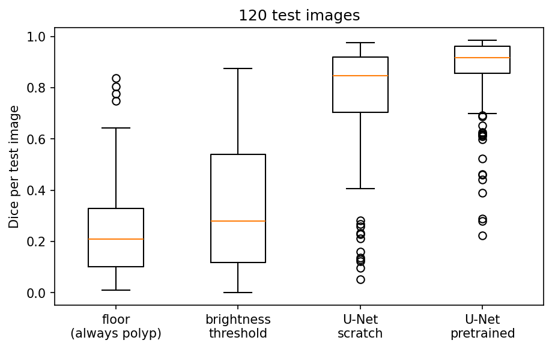
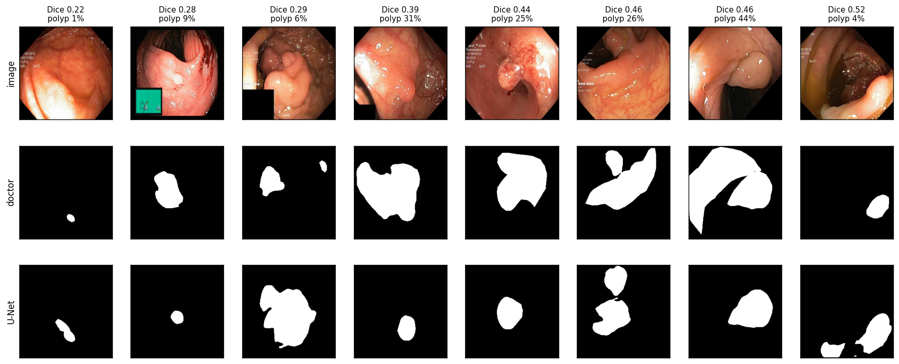
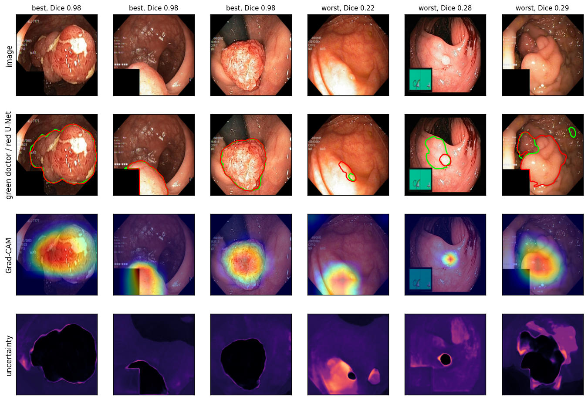

# Outlining polyps in colonoscopy images: a pretrained U-Net reaches Dice 0.86, a brightness threshold 0.32

**Biomedical Image Analysis · M.Sc. Applied Data Science and AI · SRH University Munich · Winter semester 2026/27**
**Author(s):** Chandana Gurusiddappa, Dineshkumar Swaminathan · **Repository:** https://github.com/Chandana18G/kvasir-seg-polyp-segmentation · **Date:** 24.11.2026

**Who did which part:** Chandana Gurusiddappa did the data preparation and checks, the baseline, the U-Nets, the evaluation and the report (code drafted with Claude Code, see section 7 and `AI_USAGE.md`). Dineshkumar Swaminathan did the extra analysis of which test images are hard (`dinesh/`, section 5).

---

## Abstract

Can a network outline polyps in colonoscopy images well enough to help a doctor not miss one? We used Kvasir-SEG (1,000 frames with doctor-checked masks; no patient IDs), removed near-duplicates, and kept the authors' 120 test images for a single final test. A classical brightness threshold (Otsu) reached Dice 0.323 on test, only a little above the trivial "always polyp" floor (0.243). A U-Net with a ResNet-34 encoder reached Dice 0.756 ± 0.009 when trained from scratch and **0.862 ± 0.007** when the encoder started from ImageNet weights (3 seeds each; 95 % bootstrap interval 0.832–0.888); pretraining helped most for small polyps (0.843 vs. 0.706). Errors remain: 7 of 120 test images score below 0.5, mostly by drawing the polyp too small, and images from a later batch score lower (0.809 vs. 0.874). The result comes from one hospital group and one endoscope maker, on single frames, without a patient-level split, so it does not show how the model works in other hospitals or in live video.

## 1 · The biomedical problem (15 %, with section 2)

- **Clinical question:** Colorectal polyps can turn into cancer, and polyps that are missed during colonoscopy are a known risk. A tool that outlines the polyp in each video frame could help the doctor not miss one. We ask: can a U-Net outline polyps in single colonoscopy frames well enough for this, and how much better is it than a simple brightness threshold? The user would be the endoscopist, as a second pair of eyes; the decision (remove the polyp or not) stays with the doctor.
- **Task type:** Segmentation. In: one RGB colonoscopy frame. Out: a mask with one value per pixel, polyp or background.
- **Why it is hard:** polyps vary from tiny (0.5 % of the image) to almost the whole frame, and 20 % of images have a polyp under 5 % of the image; about 85 % of pixels are background; flat polyps look like the bowel wall; light reflections, blur, stool and instruments; only 1,000 images from one hospital group; no patient IDs, so the same patient may be in training and test.

## 2 · The data (15 %, with section 1)

| | |
|---|---|
| Source, version, download date | Kvasir-SEG, https://datasets.simula.no/kvasir-seg/ (`kvasir-seg.zip`, 46 MB, unchanged since 18.11.2019), downloaded 19.11.2026. Paper: Jha et al., *Kvasir-SEG: A Segmented Polyp Dataset*, MMM 2020, LNCS 11962, pp. 451–462. Split lists from the authors' GitHub (`DebeshJha/Kvasir-SEG`, `Data-split/`). |
| Licence | No named licence. Research and educational use only, no commercial use without written permission, the paper must be cited. So the images are not in our repository; `scripts/download_data.py` fetches them. |
| Modality | Endoscopy (colonoscopy, Olympus endoscopes, Vestre Viken Health Trust, Norway); 2D RGB video frames. |
| Size | 1,000 images, each with one polyp mask. Number of patients: not reported (no patient IDs). 333 different image sizes, 332 × 352 to 1920 × 1072 px (most common 622 × 530). Pixel size in mm: not reported; endoscopy has no fixed scale. |
| Labels: who made them | An engineer and a medical doctor outlined the polyps in Labelbox; one experienced gastroenterologist checked them. |
| Labels: agreement | Not reported (one final mask per image; separate outlines not released). Ceiling therefore unknown. |
| Classes or targets | Two classes per pixel: polyp / background. Every image contains a polyp. Polyp share per image: mean 15.4 %, median 11.4 %, min 0.5 %, max 81 %; 200 of 1,000 images under 5 %. Floor on test: "always background" Dice 0.000; "always polyp" Dice 0.243 ± 0.184. |
| Splits | **Not by patient**: no patient IDs exist. Test = the authors' 120 images; validation = 100 random training images without near-copies (seed 42); train = 779; 1 image dropped (copy of a test image). |
| Preprocessing | Masks binarised with > 127 (0.73 % of mask pixels are grey from JPEG). All images and masks shrunk to 256 × 256 (images bilinear, masks nearest-neighbour). Normalisation: ImageNet values or training-set statistics only. |
| Quality checks | No broken files; every mask has the same size as its image; no empty mask. 20 images looked at by eye: black octagon border, black corner box (blacked-out position map), date/time text, reflections, sometimes instruments; masks look tight. Duplicates: 0 byte-identical, 7 near-duplicate pairs (fingerprint + mask overlap), 0 mirrored; one same-polyp pair across train/validation found by eye. **Test differs from train**: 13 test images (and no training image) still show the coloured position box; 23 test images come from a later batch with no training images. |
| Shared with Deep Learning? | No. The DL project (same partners) reproduces LSTNet on time series; all data preparation here is for this course only. |

*Figure 1: 20 random images (seed 0) with their masks in green. Made by `chandana/02_look_and_leakage.ipynb`.*

## 3 · Experimental design (15 %)

- **The floor:** "always background" (Dice 0.000, every image has a polyp) and "always polyp" (Dice 0.243 ± 0.184 on test), computed from the masks, no training.
- **Classical baseline** (`src/baseline.py`): Lab lightness L, Otsu threshold inside the endoscope view, opening and closing, keep the largest region. Our first idea was redness (Lab a*); it scored Dice 0.02 on validation. Measuring showed why: polyps are brighter than the surrounding wall in 90 % of validation images (L +37 on 0–255) but hardly redder (a* +3.8). With lightness, validation Dice is 0.39. The clean-up radius (3, 7, 11 or 15 px) is chosen on validation.
- **Deep-learning model** (`src/unet.py`): a 2D U-Net with a ResNet-34 encoder and a 4-step decoder with skip connections; one output per pixel. Loss: binary cross-entropy + Dice loss (cross-entropy gives smooth gradients; Dice loss counters the 85 % background). Adam, learning rate 1e-4, batch 16, 30 epochs, input 256 × 256, ImageNet mean/std; the epoch with the best validation Dice is kept; threshold 0.5, fixed in advance.
- **Augmentation** (training images only, `src/train.py`): left-right and up-down flips and 90° turns (an endoscope can see a polyp from any side and rotation, so these are plausible), brightness ± 10 % (the light changes with distance). No hue changes, because colour and brightness are real cues here.
- **Comparisons:** one change at a time. The two U-Nets differ only in the encoder's starting weights: random ("from scratch") vs. ImageNet-pretrained. Same split, epochs, settings and seeds (0, 1, 2); mean ± standard deviation over the 3 seeds.

## 4 · Implementation and reproducibility (25 %)

- **Run it:** `pip install -r requirements.txt`, then `python scripts/download_data.py`, `python scripts/make_split.py`, then in `chandana/` the notebooks `01`, `02`, `BIA_W6_Project_Template_PartA`, and `03_models_and_evaluation` on Google Colab (T4 GPU, Runtime → Run all). Every notebook clones the repository and downloads the data itself when run on Colab. The download script handles the Simula server's incomplete certificate chain (certificate checking stays on).
- **Seeds, hardware, training time:** split seed 42; training seeds 0, 1, 2; Google Colab T4 GPU; 18.3 s per epoch, 6 runs × 30 epochs ≈ 55 minutes. Each finished run is saved to Google Drive, so a disconnect does not lose it (our first full run was lost to a Colab disconnect). The brightness baseline needs no GPU (about 20 s for 100 images).
- **Where the results come from:**

| Output | Made by |
|---|---|
| `results/fig_polyp_share.png`, floor | `chandana/01_data_and_floor.ipynb` |
| `results/fig_20_examples.png`, `results/fig_closest_pairs.png` | `chandana/02_look_and_leakage.ipynb` |
| `splits/*.txt`, `results/duplicates.csv` | `scripts/make_split.py` |
| `results/A1_examples.png`, `A2_counts.csv`, `A5_data_table.md` | `chandana/BIA_W6_Project_Template_PartA.ipynb` |
| `results/B1_*`, `B2_*`, `C1_*` … `C5_*` | `chandana/03_models_and_evaluation.ipynb` |
| `results/B5_sanity.png`, `C3_calibration.*`, `requirements.txt` (exact versions from Colab) | `chandana/04_template_extras.ipynb` (loads the saved models, no training) |
| `results/D1_*` | `dinesh/hard_images.ipynb` |
| `results/C6_stats.md` | `python src/stats.py` |

## 5 · Evaluation, validation and critical analysis (15 %)

Test set: the authors' 120 images, 256 × 256, threshold 0.5, mean over images; ± = standard deviation over 3 seeds (`results/C1_results.md`).

| Setting | Dice | IoU | Precision | Recall | Seeds |
|---|---|---|---|---|---|
| floor: always background | 0.000 | 0.000 | 0.000 | 0.000 | – |
| floor: always polyp | 0.243 | 0.153 | 0.153 | 1.000 | – |
| brightness threshold (Otsu, radius 11) | 0.323 | 0.223 | 0.304 | 0.598 | – |
| U-Net, encoder from scratch | 0.756 ± 0.009 | 0.661 ± 0.014 | 0.790 ± 0.025 | 0.807 ± 0.021 | 3 |
| + ImageNet-pretrained encoder | **0.862 ± 0.007** | **0.788 ± 0.011** | **0.864 ± 0.029** | **0.912 ± 0.016** | 3 |

**How sure, and for whom** (`results/C2_intervals_and_groups.md`; U-Net Dice per image = mean of its 3 seeds):

| Setting | 95 % bootstrap interval | small polyps < 5 % (n = 29) | later batch (n = 23) | rest (n = 97) |
|---|---|---|---|---|
| brightness threshold | 0.282 – 0.370 | 0.146 | 0.304 | 0.328 |
| U-Net scratch | 0.712 – 0.795 | 0.706 | 0.754 | 0.756 |
| U-Net pretrained | 0.832 – 0.888 | 0.843 | 0.809 | 0.874 |

*Figure 2: Dice per test image for the floor, the threshold and both U-Nets (`chandana/03`, C1).*

- **Statistical tests** (`src/stats.py` → `results/C6_stats.md`): paired over the 120 test images, Holm-corrected over 3 comparisons. Threshold vs floor: +0.080 Dice, Wilcoxon p = 1.3 × 10⁻⁴; U-Net scratch vs threshold: +0.432, p = 2.4 × 10⁻¹⁸; **U-Net pretrained vs scratch: +0.106, better on 104 of 120 images, p = 5.3 × 10⁻¹³** (paired t-test gives the same conclusion). A test over seeds is not possible with 3 seeds (Wilcoxon needs at least 6); the seed spread is reported as ± std instead.
- **What the numbers say:** every step up the ladder helps, and the intervals do not overlap. Pretraining, the one change between the two U-Nets, adds 0.106 Dice; it is better on 104 of 120 test images. The seed spread (± 0.007–0.009) is much smaller than the gap, so the gap is not luck of the random start. Our pretrained result is close to the published U-Net with a ResNet-34 encoder on the same split (Dice 0.876 at 512 px, Jha et al. 2021), with smaller images (256 px) and only 30 epochs.
- **Learning curves** (`results/B2_learning_curves.png`): the pretrained U-Net reaches validation Dice 0.80 after 2 epochs and levels off near 0.86 after about 10. The scratch U-Net is still rising at epoch 30 (best epochs 27–29), so with a bigger budget the gap would likely shrink; with the **same** budget, pretraining clearly wins.
- **The baseline:** brightness finds the polyp's general area (recall 0.60) but also grabs reflections and pale folds (precision 0.30). It fails for small polyps (0.146), where the bright area is mostly something else.
- **Metrics that fit the task:** Dice and IoU per image (each image counts the same, so small polyps are not drowned by large ones). Not pixel accuracy: "always background" would score about 85 %. Recall matters most clinically (a missed polyp is the dangerous error); the pretrained U-Net's recall is 0.912.
- **Worst cases** (`results/C3_worst_cases.png`, Figure 3): 7 of 120 test images score below 0.5, while 75 score 0.9 or more (median 0.918). The worst 8 show three patterns: (1) **drawing too small**: for large or folded polyps (25–44 % of the image) the network marks only the most prominent part; (2) **bright distractors**: a tiny polyp (1 %) next to a strong light reflection, where the network marks the bright area instead; (3) **unclear or several regions**: frames where the doctor marked two separate areas or where a pale fold looks like a polyp. 3 of the worst 8 come from the later batch (which is only 19 % of the test set), one of them with the coloured position box that never appears in training.
- **Calibration** (`results/C3_calibration.png`, `chandana/04`): grouping all test pixels by the predicted polyp probability (mean of 3 seeds), both U-Nets are close to honest: calibration error 0.023 for scratch and 0.063 for pretrained. The pretrained model slightly overestimates low probabilities (pixels it gives 5–15 % are polyp only 1–2 % of the time), which is the safe direction for not missing a polyp. So the better segmenter is not the better-calibrated one; a probability map shown to a doctor would need this check.
- **Which test images are hard** (Dinesh, `dinesh/hard_images.ipynb` → `results/D1_*`): the pretrained U-Net's Dice hardly depends on polyp size (Spearman r = +0.18) or on how much brighter the polyp is (r = +0.06), unlike the brightness baseline. The 7 images below Dice 0.5 have larger polyps than average (median 25 % vs. 12 % of the image), which matches the "drawing too small" pattern; 3 of them come from the later batch.
- **Ceiling:** unknown. Kvasir-SEG gives one consensus mask per image and no agreement between annotators. Several worst cases have borders that a second doctor might draw differently, so a Dice of 1 is not a realistic goal.
- **Test set:** used **once**, at the end, for all five settings. All choices (baseline colour channel and radius, best epoch, threshold 0.5) were made on validation. External data: none.
- **Limitations:** one dataset from one hospital group (Vestre Viken, Norway) and one endoscope maker (Olympus); single still frames, not video; no patient IDs, so the same patient may be in training and test (we removed 7 near-duplicate pairs, but frames of the same polyp from another angle remain possible); images at 256 × 256; scratch model not trained to convergence; 3 seeds only. The later-batch result (0.809 vs. 0.874) hints that performance drops on images that differ from training, so other hospitals would likely score lower.

*Figure 3: the 8 test images where the pretrained U-Net scores lowest. Rows: image, doctor's mask, U-Net (mean of 3 seeds, > 0.5).*

## 6 · Explainability, ethics and clinical responsibility (5 %)

- **Grad-CAM and uncertainty** (`results/C4_gradcam_uncertainty.png`, Figure 4): for the 3 best test images (Dice 0.98), Grad-CAM is centred on the polyp and the 3 seed models agree everywhere except a thin line at the border. For the worst images, Grad-CAM points at what misled the network, for example the bright reflection instead of the tiny polyp, and the uncertainty map is brightest in the areas that are wrong. So uncertainty is a useful warning sign: a tool could flag frames where the seed models disagree.
- **What these maps cannot show:** Grad-CAM shows which deep features increased the polyp output, at 8 × 8 resolution, so it is blurry and cannot explain the exact border; it does not prove the network uses "polyp shape" rather than brightness or texture. Low uncertainty does not mean correct: three models can agree on the same mistake.
- **Sanity check** (`results/B5_sanity.png`, template B5; Adebayo et al. 2018): we gave the U-Net's last layer random weights again and computed Grad-CAM on the same 4 test images. For 2 of the 4 the map hardly changed (correlation 0.98 and 1.00), including the best image; only for the worst image did it change clearly (0.26). So most of our Grad-CAM maps show where the encoder's features are strong, not what the network learned about polyps. We would show the worst image's map (it depends on training) but not trust the best image's map, even though it looks convincing. Randomising only the final 1 × 1 layer is a mild test for a U-Net; randomising the whole decoder would be stronger.

*Figure 4: 3 best and 3 worst test images. Rows: image; doctor (green) vs. U-Net (red); Grad-CAM of the pretrained U-Net (seed 0); uncertainty (standard deviation of the 3 seeds).*
- **Who could be harmed:** a missed polyp (false negative) can grow into cancer; that is why we report recall, results for small polyps separately, and the worst cases. A false alarm costs time and maybe an unneeded biopsy. The tool may only point; the doctor must still look at the whole frame, judge every polyp, and decide on removal. It has only been tested on images from one hospital group and one endoscope maker.
- **Privacy:** the images are anonymised (random file names), but many frames show the date and time of the examination in the corner. We do not publish the raw images; the figures in this repository show a few downsized frames for teaching, as the licence allows with citation.

## 7 · Use of AI tools (5 %)

**Tool:** Claude Code (Anthropic), an AI coding assistant.

**What we used it for:**
- **Research:** facts about Kvasir-SEG (paper, licence, annotators, the authors' split) and published results for comparison. We checked each fact against the dataset page or the downloaded files; two claims from the literature turned out to be wrong or incomplete for our copy (the "blacked-out" position box is still visible in 13 test images, and the masks contain only 0.73 % grey pixels, not the widely mentioned noisy masks).
- **Drafting code:** the download and split scripts, `src/` (data, duplicates, metrics, baseline, U-Net, training) and the notebooks.
- **Debugging:** the Colab certificate error on the Simula server, a Windows text-encoding problem, and making the training resumable after a Colab disconnect.
- **Drafting text:** parts of this report and the README.

**How we checked it:**
- We ran every notebook ourselves and looked at every figure.
- We checked the duplicate rule by eye on the 25 closest image pairs.
- We tested assumptions on the data before trusting them. The first suggested baseline (redness) scored Dice 0.02 on validation; measuring showed polyps are brighter, not redder, so we changed it.
- We checked that the same number comes out of different code: the floor is 0.243 in notebooks 01, the template Part A and 03. A fresh clone from GitHub rebuilt identical split files.
- We compared our U-Net result with the published one on the same split.
- We read every file until we could explain each step; the code is kept short and commented for that reason.

**Where it was wrong:** the redness baseline idea; a first claim that some masks extend under the black corner box (a pixel check showed they do not); a note that a same-polyp pair was in training only (it is split across training and validation).

## 8 · Conclusion (documentation and communication, 5 %)

**What we found:** on Kvasir-SEG, a U-Net with an ImageNet-pretrained ResNet-34 encoder outlines polyps with a test Dice of 0.862 ± 0.007 (3 seeds), far above a brightness threshold (0.323) and the floor (0.243). Pretraining is the single change that adds the most (+0.106 against the same U-Net from scratch), and it helps most where it matters clinically: small polyps (0.843 vs. 0.706).

**How sure we are:** sure about the ranking (the bootstrap intervals do not overlap, and the seed spread is small); less sure about the exact number, because the test set has only 120 images, there is no patient-level split, and all images come from one hospital group. The lower score on the later batch (0.809) is a warning that new images will score lower.

**What we would do next:** train the scratch model longer to see how much of the gap is speed rather than final quality; use full resolution or 512 px for small polyps; test on another dataset from a different hospital (for example CVC-ClinicDB) as an external test; use the seed disagreement as a "please check this frame" signal; and move from single frames to video, where a polyp seen in several frames is easier to confirm.

## References

- Jha D., Smedsrud P. H., Riegler M. A., Halvorsen P., de Lange T., Johansen D., Johansen H. D. *Kvasir-SEG: A Segmented Polyp Dataset.* MultiMedia Modeling (MMM 2020), LNCS 11962, pp. 451–462. https://doi.org/10.1007/978-3-030-37734-2_37 · Data: https://datasets.simula.no/kvasir-seg/ · Split: https://github.com/DebeshJha/Kvasir-SEG/tree/master/Data-split
- Ronneberger O., Fischer P., Brox T. *U-Net: Convolutional Networks for Biomedical Image Segmentation.* MICCAI 2015.
- He K., Zhang X., Ren S., Sun J. *Deep Residual Learning for Image Recognition* (ResNet). CVPR 2016. Weights: torchvision `ResNet34_Weights.IMAGENET1K_V1`.
- Otsu N. *A Threshold Selection Method from Gray-Level Histograms.* IEEE Trans. SMC, 1979.
- Adebayo J. et al. *Sanity Checks for Saliency Maps.* NeurIPS 2018.
- Selvaraju R. R. et al. *Grad-CAM: Visual Explanations from Deep Networks via Gradient-based Localization.* ICCV 2017.
- Jha D. et al. *A Comprehensive Study on Colorectal Polyp Segmentation with ResUNet++, Conditional Random Field and Test-Time Augmentation.* IEEE JBHI 2021 (same 880/120 split; U-Net with ResNet-34 encoder Dice 0.876 at 512 px).
- Course material: Cerit J., Biomedical Image Analysis, SRH University Munich, WS 2026/27 (Sessions 1–13, project template).
